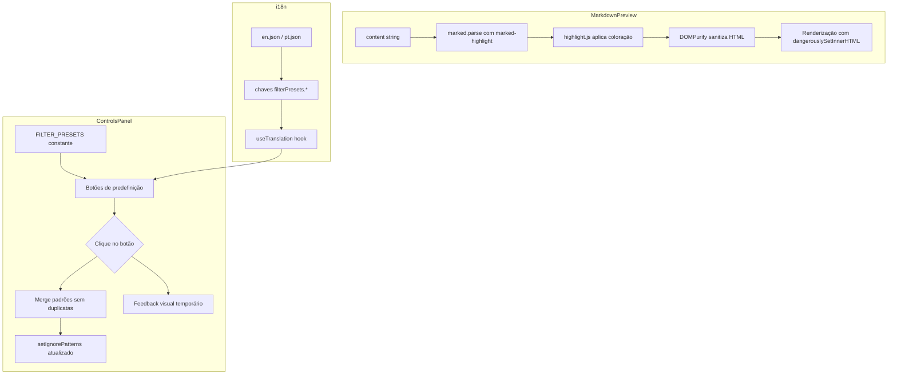

# Documento de Design — UX Improvements

## Visão Geral

Este documento descreve o design técnico para três melhorias de UX no Project Unifier:

1. **Realce de sintaxe** nos blocos de código do componente `MarkdownPreview`, utilizando uma biblioteca de highlighting.
2. **Predefinições de filtros por stack tecnológica** no `ControlsPanel`, permitindo aplicar conjuntos de padrões de exclusão com um clique.
3. **Internacionalização (i18n)** dos rótulos das predefinições de filtro, integrando-os nos ficheiros `en.json` e `pt.json` existentes.

### Pesquisa: Biblioteca de Syntax Highlighting

Foram consideradas três opções principais:

| Biblioteca | Tamanho (bundle) | Abordagem | Tema escuro | Integração com `marked` |
|---|---|---|---|---|
| **highlight.js** | ~30 KB (core) | Runtime DOM | Vários temas escuros | Plugin `marked-highlight` oficial |
| **Prism.js** | ~20 KB (core) | Runtime DOM | Temas escuros disponíveis | Requer custom renderer |
| **Shiki** | ~200 KB+ | WASM/TextMate | VS Code themes | Assíncrono, mais complexo |

**Decisão:** Utilizar **highlight.js** com o plugin `marked-highlight`. Razões:
- Integração direta com `marked` via pacote `marked-highlight` (já usado no projeto).
- Suporte nativo a todas as linguagens do `LANG_MAP` sem configuração extra.
- Temas escuros prontos (ex: `github-dark`, `atom-one-dark`) que combinam com o esquema slate da aplicação.
- Fallback gracioso: se a linguagem não for reconhecida, renderiza como texto simples.
- Bundle razoável e sem dependência de WASM.

## Arquitetura



## Componentes e Interfaces

### 1. MarkdownPreview (modificação)

**Ficheiro:** `components/MarkdownPreview.tsx`

Alterações:
- Importar `highlight.js` (core + linguagens necessárias) e o tema CSS escuro.
- Configurar `marked` com a extensão `marked-highlight` para delegar o highlighting ao `hljs`.
- O renderer de código invoca `hljs.highlight(code, { language })` quando a linguagem é conhecida, e `hljs.highlightAuto(code)` ou texto simples quando não é.
- Envolver a chamada em try/catch para fallback gracioso.

```typescript
interface MarkdownPreviewProps {
    content: string;
}
```

Nenhuma alteração na interface pública — apenas a implementação interna muda.

### 2. ControlsPanel (modificação)

**Ficheiro:** `components/ControlsPanel.tsx`

Alterações:
- Importar a constante `FILTER_PRESETS` de `lib/filterPresets.ts`.
- Adicionar secção de botões de predefinição acima ou abaixo da lista de padrões de exclusão.
- Cada botão mostra o rótulo traduzido via `t('filterPresets.<id>.label')`.
- Ao clicar, faz merge dos padrões da predefinição com os existentes (sem duplicatas).
- Estado local `appliedPresets: Set<string>` para feedback visual (ícone de check temporário).

### 3. filterPresets (novo módulo)

**Ficheiro:** `lib/filterPresets.ts`

```typescript
export interface FilterPreset {
    id: string;           // chave única, ex: "nodejs"
    translationKey: string; // chave i18n, ex: "filterPresets.nodejs.label"
    patterns: string[];   // padrões glob a adicionar
}

export const FILTER_PRESETS: FilterPreset[] = [
    {
        id: 'nodejs',
        translationKey: 'filterPresets.nodejs.label',
        patterns: ['node_modules', 'package-lock.json', 'yarn.lock', 'pnpm-lock.yaml', '.npm', '.yarn'],
    },
    {
        id: 'staticAssets',
        translationKey: 'filterPresets.staticAssets.label',
        patterns: [
            '*.png', '*.jpg', '*.jpeg', '*.gif', '*.svg', '*.ico', '*.webp',
            '*.mp4', '*.webm', '*.mp3', '*.wav', '*.ogg',
            '*.ttf', '*.woff', '*.woff2', '*.eot',
        ],
    },
    {
        id: 'minified',
        translationKey: 'filterPresets.minified.label',
        patterns: ['*.min.js', '*.min.css', '*.min.map', '*.bundle.js', '*.chunk.js'],
    },
];
```

### 4. Ficheiros de tradução (modificação)

**Ficheiros:** `lib/translations/en.json`, `lib/translations/pt.json`

Adicionar secção `filterPresets`:

```json
// en.json
"filterPresets": {
    "title": "Filter Presets",
    "nodejs": { "label": "Node.js" },
    "staticAssets": { "label": "Static Assets" },
    "minified": { "label": "Minified Files" },
    "applied": "Applied!"
}
```

```json
// pt.json
"filterPresets": {
    "title": "Predefinições de Filtro",
    "nodejs": { "label": "Node.js" },
    "staticAssets": { "label": "Assets Estáticos" },
    "minified": { "label": "Ficheiros Minificados" },
    "applied": "Aplicado!"
}
```

## Modelos de Dados

### FilterPreset

| Campo | Tipo | Descrição |
|---|---|---|
| `id` | `string` | Identificador único da predefinição |
| `translationKey` | `string` | Chave de tradução para o rótulo |
| `patterns` | `string[]` | Lista de padrões glob de exclusão |

### Estado do ControlsPanel (adições)

| Campo | Tipo | Descrição |
|---|---|---|
| `appliedPresets` | `Set<string>` | IDs das predefinições recém-aplicadas (para feedback visual) |

### Configuração do highlight.js

Não introduz novos modelos de dados. A configuração é feita via `marked-highlight` que recebe uma função de callback:

```typescript
{
    langPrefix: 'hljs language-',
    highlight(code: string, lang: string): string {
        // retorna HTML com spans coloridos
    }
}
```


## Propriedades de Correção

*Uma propriedade é uma característica ou comportamento que deve ser verdadeiro em todas as execuções válidas de um sistema — essencialmente, uma declaração formal sobre o que o sistema deve fazer. As propriedades servem como ponte entre especificações legíveis por humanos e garantias de correção verificáveis por máquina.*

### Propriedade 1: Highlighting aplicado para linguagens conhecidas

*Para qualquer* string de código e qualquer linguagem presente no LANG_MAP, ao renderizar um bloco de código Markdown com essa linguagem especificada (`` ```lang ``), o HTML resultante deve conter elementos `<span>` com classes de highlighting do hljs (ex: `hljs-keyword`, `hljs-string`), indicando que o realce de sintaxe foi aplicado.

**Valida: Requisitos 1.1, 1.5**

### Propriedade 2: Sem highlighting quando linguagem não é especificada

*Para qualquer* string de código, ao renderizar um bloco de código Markdown sem linguagem especificada (`` ``` `` sem identificador), o HTML resultante do bloco `<code>` não deve conter elementos `<span>` com classes de highlighting do hljs.

**Valida: Requisito 1.2**

### Propriedade 3: Cobertura de linguagens do LANG_MAP

*Para qualquer* linguagem definida no LANG_MAP, o highlight.js deve reconhecer essa linguagem (i.e., `hljs.getLanguage(lang)` retorna um valor truthy), garantindo suporte completo.

**Valida: Requisito 1.3**

### Propriedade 4: Merge de predefinições é uma união de conjuntos

*Para qualquer* lista de padrões existentes e qualquer predefinição de filtro, aplicar a predefinição deve resultar numa lista que: (a) contém todos os padrões originais, (b) contém todos os padrões da predefinição, e (c) não contém duplicatas. Aplicar a mesma predefinição duas vezes deve produzir o mesmo resultado que aplicá-la uma vez (idempotência).

**Valida: Requisitos 2.3, 2.4**

### Propriedade 5: Chaves de tradução existem para todas as predefinições em todos os idiomas

*Para qualquer* predefinição em FILTER_PRESETS e *para qualquer* locale suportado (en, pt), a chave de tradução correspondente (`filterPresets.<id>.label`) deve existir no ficheiro de tradução desse locale e retornar uma string não vazia.

**Valida: Requisito 3.1**

## Tratamento de Erros

| Cenário | Comportamento | Implementação |
|---|---|---|
| Linguagem desconhecida no highlight.js | Renderizar bloco como texto simples | try/catch no callback do `marked-highlight`; retorna código sem spans |
| highlight.js lança exceção inesperada | Renderizar bloco como texto simples | Mesmo try/catch; log de warning na consola |
| Predefinição com padrões inválidos | Padrões são adicionados como strings (validação é feita pelo picomatch no processamento) | Sem validação extra necessária — picomatch já ignora padrões inválidos |
| Chave de tradução em falta | Retorna a chave como fallback | Comportamento existente do hook `useTranslation` |

## Estratégia de Testes

### Abordagem Dual

A estratégia combina testes unitários (exemplos específicos) com testes baseados em propriedades (verificação universal):

- **Testes unitários**: Verificam exemplos concretos, edge cases e condições de erro.
- **Testes de propriedade**: Verificam propriedades universais com inputs gerados aleatoriamente.

### Biblioteca de Property-Based Testing

Utilizar **fast-check** (`fc`) para TypeScript/JavaScript. É a biblioteca PBT mais madura para o ecossistema JS/TS, com excelente suporte a arbitrários customizados.

### Testes Unitários

1. **MarkdownPreview**: Renderizar bloco com `typescript` e verificar que o HTML contém classes hljs.
2. **MarkdownPreview**: Renderizar bloco sem linguagem e verificar ausência de classes hljs.
3. **MarkdownPreview**: Renderizar bloco com linguagem inválida e verificar fallback para texto simples (edge case do requisito 1.6).
4. **ControlsPanel**: Verificar que a secção de predefinições é renderizada (requisito 2.1).
5. **ControlsPanel**: Verificar que as 3 predefinições obrigatórias existem com os padrões corretos (requisito 2.2).
6. **ControlsPanel**: Verificar feedback visual após aplicar predefinição (requisito 2.6).
7. **i18n**: Verificar que alterar o idioma atualiza os rótulos das predefinições (requisito 3.2).

### Testes de Propriedade

Cada teste deve executar no mínimo 100 iterações.

1. **Feature: ux-improvements, Property 1: Highlighting aplicado para linguagens conhecidas**
   - Gerar strings de código aleatórias e linguagens aleatórias do LANG_MAP.
   - Verificar que o HTML resultante contém spans com classes hljs.

2. **Feature: ux-improvements, Property 2: Sem highlighting quando linguagem não é especificada**
   - Gerar strings de código aleatórias sem especificador de linguagem.
   - Verificar que o HTML resultante não contém spans hljs dentro do bloco `<code>`.

3. **Feature: ux-improvements, Property 3: Cobertura de linguagens do LANG_MAP**
   - Para cada linguagem no LANG_MAP, verificar que `hljs.getLanguage(lang)` retorna truthy.

4. **Feature: ux-improvements, Property 4: Merge de predefinições é uma união de conjuntos**
   - Gerar listas aleatórias de padrões existentes e selecionar predefinições aleatórias.
   - Verificar que o resultado é a união sem duplicatas e que a operação é idempotente.

5. **Feature: ux-improvements, Property 5: Chaves de tradução existem para todas as predefinições em todos os idiomas**
   - Para cada predefinição e cada locale, verificar que a chave de tradução existe e é não vazia.
